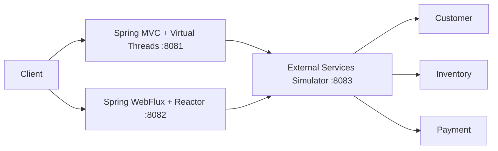

# Java Architecture Decision Lab

A production-minded Java 21 and Spring Boot laboratory for exploring architectural trade-offs with executable evidence instead of framework hype.

The first lab implements the same I/O-bound checkout flow twice:

- **Spring MVC + Virtual Threads**
- **Spring WebFlux + Reactor**

Both implementations use the same downstream simulator, functional contract, observability contract, load scenarios, and evidence protocol.

> **This is not a definitive benchmark.**
>
> The project is designed to explain behavior and trade-offs under documented conditions, not to manufacture a universal winner.

## What is included

- Java 21 and Spring Boot 3.5.16
- Maven multi-module build
- external customer, inventory, and payment simulator
- MVC checkout running on Virtual Threads
- equivalent WebFlux/Reactor checkout
- Actuator, Prometheus metrics, structured logs, correlation IDs, liveness, and readiness
- Docker Compose orchestration
- deterministic smoke tests
- parameterized k6 scenarios
- JFR, JVM diagnostics, Docker statistics, and environment capture scripts
- ADRs and an evidence-first comparative analysis template
- GitHub Actions build and runtime verification

## Architecture



Both checkout services execute the same business flow:

1. validate the request;
2. retrieve the customer;
3. check inventory;
4. authorize payment;
5. persist the order with a controlled delay;
6. publish `OrderConfirmed` with a controlled delay;
7. return a confirmed checkout response.

## Requirements

- JDK 21
- Docker Engine
- Docker Compose v2
- Bash, Make, curl, and unzip

Maven is downloaded automatically by the repository wrapper and verified with SHA-512.

## One-command verification

```bash
./scripts/verify-all.sh
```

The command:

1. runs the complete Maven test lifecycle;
2. validates Docker Compose;
3. builds and starts all three services;
4. waits for readiness;
5. validates simulator, checkout, observability, and correlation-ID contracts;
6. always removes the containers.

## Manual execution

```bash
docker compose \
  -f labs/01-loom-vs-reactive-checkout/docker-compose.yml \
  up --build -d
```

Run smoke tests:

```bash
make -C labs/01-loom-vs-reactive-checkout smoke
```

Stop everything:

```bash
make -C labs/01-loom-vs-reactive-checkout down
```

## Endpoints

| Service | URL |
|---|---|
| MVC + Virtual Threads | `http://localhost:8081` |
| WebFlux + Reactor | `http://localhost:8082` |
| External services simulator | `http://localhost:8083` |

Checkout contract:

```text
POST /orders/checkout
```

Actuator and Prometheus:

```text
/actuator/health
/actuator/health/liveness
/actuator/health/readiness
/actuator/info
/actuator/metrics
/actuator/prometheus
```

## Load tests

Install k6, start the services, and run:

```bash
IMPLEMENTATION=mvc-vthreads SCENARIO=functional \
  labs/01-loom-vs-reactive-checkout/scripts/run-load-test.sh

IMPLEMENTATION=webflux-reactor SCENARIO=moderate \
  labs/01-loom-vs-reactive-checkout/scripts/run-load-test.sh
```

Available scenarios:

```text
functional
moderate
high
capacity
slow-payment
intermittent-failures
```

## Automated evidence and profiling

Run one complete measured session:

```bash
labs/01-loom-vs-reactive-checkout/scripts/run-evidence.sh \
  --implementation mvc-vthreads \
  --scenario moderate
```

Run the four-pair protocol for both implementations:

```bash
labs/01-loom-vs-reactive-checkout/scripts/run-evidence-suite.sh \
  --scenarios moderate,high \
  --pairs 4
```


> **Runtime and progress:** `moderate,high` with `--pairs 4` means 16 isolated runs. The suite prints a host-specific estimate, `[SUITE current/total]` progress, k6 heartbeats, watchdog failures, and an exact resume command. See [`docs/troubleshooting/evidence-suite-progress-and-recovery.md`](docs/troubleshooting/evidence-suite-progress-and-recovery.md).

Resume a partial suite without repeating completed runs:

```bash
labs/01-loom-vs-reactive-checkout/scripts/run-evidence-suite.sh \
  --scenarios moderate,high \
  --pairs 4 \
  --resume .artifacts/evidence/<SUITE_ID>-paired-evidence
```

The pipeline automates environment manifests, equal container limits, warm-up, k6, Actuator snapshots, Docker statistics, `jcmd` diagnostics, bounded JFR, structured JFR metrics, normalized summaries, comparison tables, cleanup, and SHA-256 manifests. A resume is accepted only when Git SHA, locale-stable protocol fingerprint, workload identity, and the complete runtime/resource configuration fingerprint remain identical. The bundled curated suite is historical protocol v4 evidence; the current runner is protocol v5 for future measurements.

Materialize the completed suite into linked Markdown/JSON/CSV documentation without copy and paste:

```bash
make -C labs/01-loom-vs-reactive-checkout evidence-docs \
  UPDATE_ANALYSIS=1
```

The command updates only the generated evidence block in the comparative analysis; hypotheses and engineering interpretation remain manual and preserved.

Optionally start an interactive native VisualVM diagnostic session:

```bash
labs/01-loom-vs-reactive-checkout/scripts/visualvm-session.sh start mvc-vthreads
labs/01-loom-vs-reactive-checkout/scripts/visualvm-session.sh load moderate
labs/01-loom-vs-reactive-checkout/scripts/visualvm-session.sh stop
```

See:

- [`docs/profiling/AUTOMATED_EVIDENCE_PIPELINE.md`](docs/profiling/AUTOMATED_EVIDENCE_PIPELINE.md)
- [`docs/profiling/AUTOMATED_DOCUMENTATION_WORKFLOW.md`](docs/profiling/AUTOMATED_DOCUMENTATION_WORKFLOW.md)
- [`docs/profiling/EVIDENCE_ARTIFACT_MANIFEST.md`](docs/profiling/EVIDENCE_ARTIFACT_MANIFEST.md)
- [`docs/profiling/visualvm-setup.md`](docs/profiling/visualvm-setup.md)
- [`docs/profiling/jfr-setup.md`](docs/profiling/jfr-setup.md)
- [`docs/load-test-protocol.md`](docs/load-test-protocol.md)
- [`docs/runbook/MASTER_RUNBOOK.md`](docs/runbook/MASTER_RUNBOOK.md)
- [`docs/runbook/BENCHMARK_PROTOCOL.md`](docs/runbook/BENCHMARK_PROTOCOL.md)
- [`docs/runbook/GITHUB_RELEASE_RUNBOOK.md`](docs/runbook/GITHUB_RELEASE_RUNBOOK.md)
- [`docs/runbook/VALIDATION_REPORT.md`](docs/runbook/VALIDATION_REPORT.md)
- [`docs/results/01-loom-vs-reactive-analysis.md`](docs/results/01-loom-vs-reactive-analysis.md)

## Repository structure

```text
java-architecture-decision-lab/
├── .github/workflows/ci.yml
├── docs/
│   ├── adr/
│   ├── profiling/
│   ├── results/
│   └── runbook/
├── labs/01-loom-vs-reactive-checkout/
│   ├── external-services-simulator/
│   ├── mvc-virtual-threads/
│   ├── webflux-reactor/
│   ├── load-tests/
│   ├── docker-compose.yml
│   └── Makefile
├── scripts/verify-all.sh
├── mvnw
└── pom.xml
```

## Architectural boundaries

This repository does not claim that:

- Loom is always better;
- WebFlux is obsolete;
- Virtual Threads automatically reduce individual latency;
- a local machine represents production;
- throughput alone decides architecture;
- fewer lines of code imply better design.

The intended conclusion is contextual:

> **Loom does not remove architectural trade-offs. It changes where the balance point is.**

## Publishing to GitHub

See [`PUBLISH_TO_GITHUB.md`](PUBLISH_TO_GITHUB.md).

## License

Apache License 2.0. See [`LICENSE`](LICENSE).
