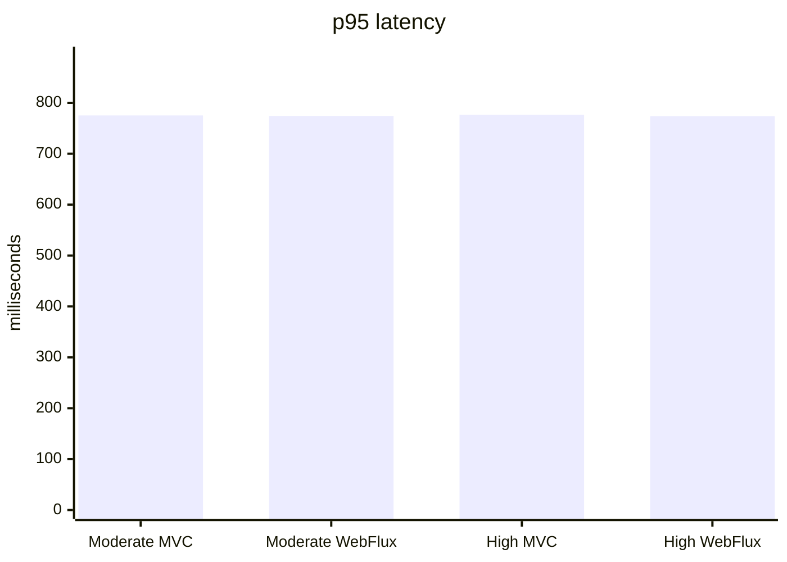
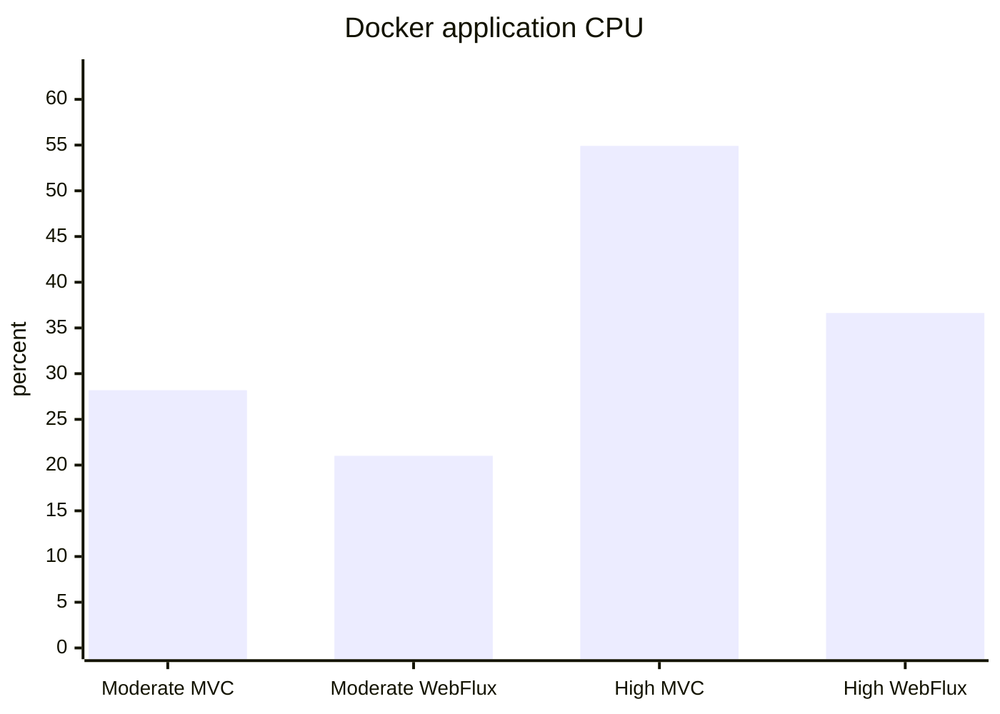
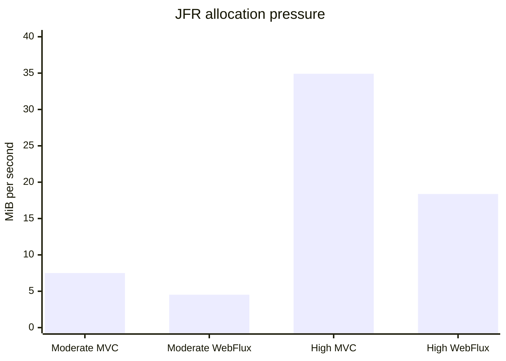
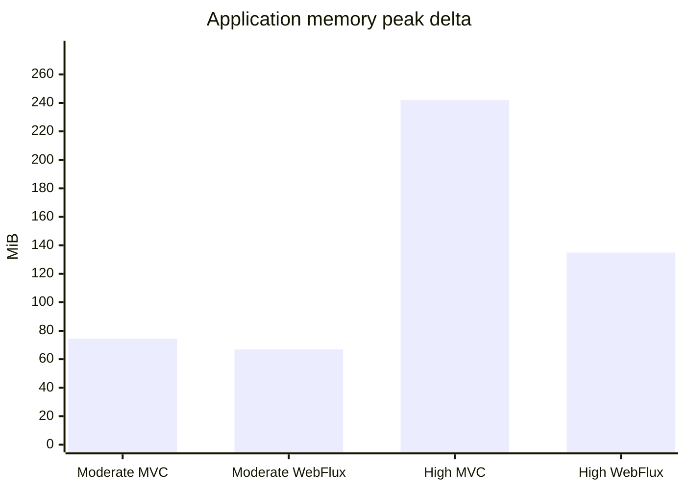
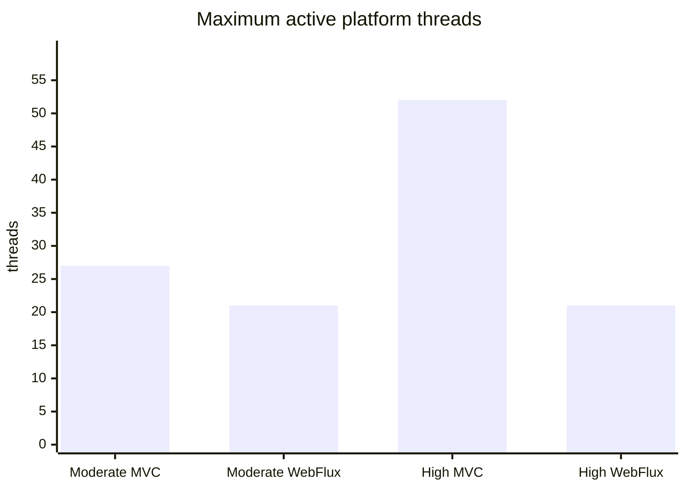

# Generated Evidence Charts

- Suite: `20260718T215210Z-paired-evidence`
- Canonical source: [`comparison-aggregates.json`](comparison-aggregates.json)
- Semantics: medians across four isolated runs per implementation and scenario.
- These diagrams are generated projections, not an independent evidence source.

## p95 latency

## Application CPU

## JFR allocation pressure

## Measured-window memory growth

## Maximum platform threads

## Interpretation boundary

Mermaid charts replace neither raw JFR nor structured JSON/CSV. They also cannot create missing incident-response, stack-trace, or human-debugging evidence.
